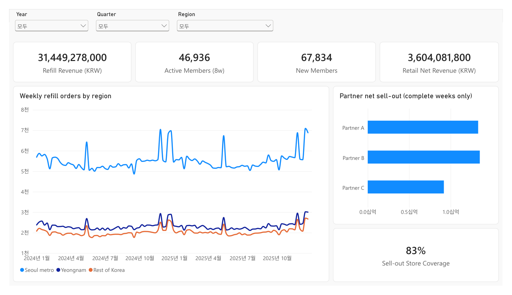
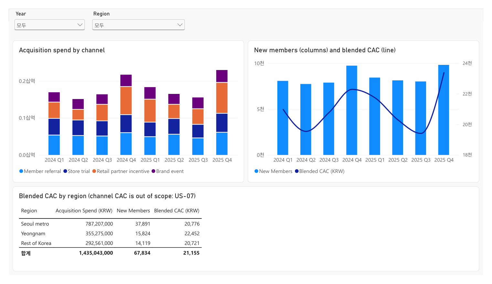
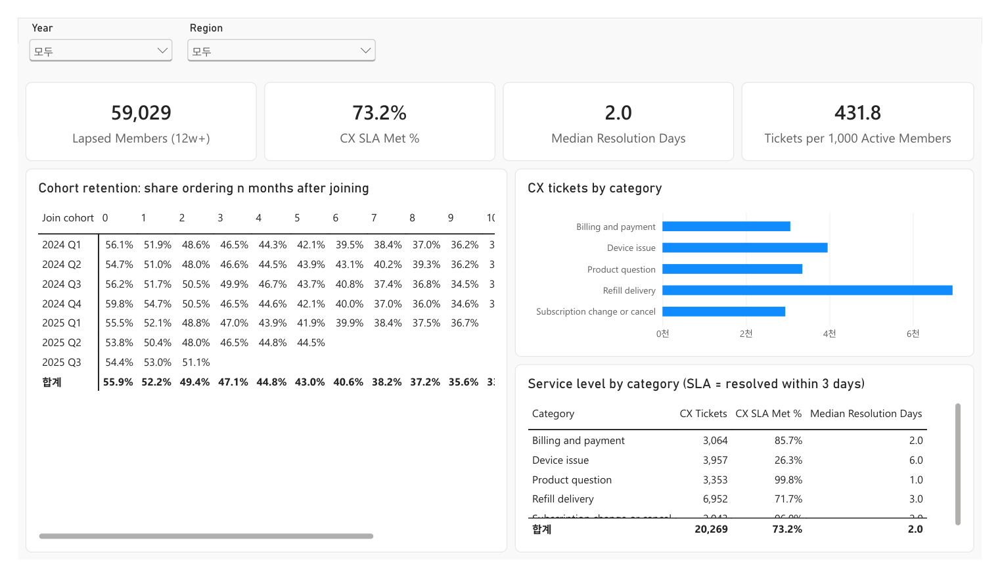
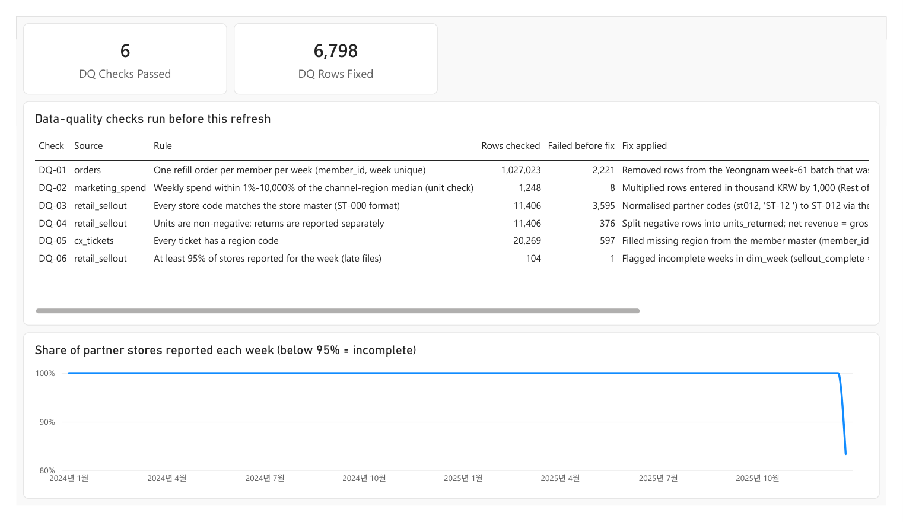

# BREWLY commercial dashboard: a Business Analyst case in Power BI (synthetic data)

Three teams at BREWLY, a fictional coffee machine and capsule brand, asked the analytics team for the same numbers every week and still disagreed on them. This case follows the work a Business Analyst does to turn those requests into one self-serve Power BI report: gather requirements, agree KPI definitions, check data quality, build the model, test it against SQL, and run UAT.

All data is synthetic. Member orders, CRM messages and spend come from the main [BREWLY project](../README.md); partner sell-out and CX tickets are generated here, with six data-quality issues planted on purpose.

## What the report answers (2025, synthetic)

- **Members:** 46,936 active members at year end and 59,029 lapsed (12+ weeks since last order). The 2024 Q1 cohort keeps 46.5% ordering in month 3.
- **Acquisition:** 733.5M KRW spend brought 34,400 new members. Blended cost per new member is similar across regions (20,800-22,200 KRW), so the budget question is about channels, which needs attribution (deferred, US-07).
- **Retail:** 1.89B KRW net partner sell-out; device return rate 3.5%.
- **CX:** 73% of resolved tickets meet the 3-day SLA, but device issues meet it only 27% of the time (median 6 days). The average hides the problem the CX manager suspected.

## The BA work, step by step

| Step | Output | File |
|---|---|---|
| 1. Requirements | Stakeholders, problems, scope, 9 business requirements | [docs/01_business_requirements.md](docs/01_business_requirements.md) |
| 2. Definitions | 14 KPIs with business rules, owners and the model | [docs/02_kpi_definitions.md](docs/02_kpi_definitions.md) |
| 3. User stories | 9 stories with acceptance criteria and MoSCoW priority, including one "won't" with the reason | [docs/03_user_stories.md](docs/03_user_stories.md) |
| 4. Process | Request-to-release flow and RACI | [docs/04_process_flow.md](docs/04_process_flow.md) |
| 5. Data quality | 6 checks: duplicate load, unit error, store codes, returns, missing region, late partner file | [docs/05_data_quality_report.md](docs/05_data_quality_report.md) |
| 6. Testing | 14 of 14 functional tests match SQL, 4 behaviour tests pass, 1 defect found and fixed; UAT script and issue log | [docs/06_test_cases_uat.md](docs/06_test_cases_uat.md) |
| 7. Report | Power BI project: star schema, 21 DAX measures, 4 report pages and a test sheet | [powerbi/](powerbi/) |

## Report pages

1. **Overview:** refill revenue, active and new members, partner sell-out, store coverage.
2. **Acquisition:** spend by channel, new members and blended CAC by quarter and region.
3. **Retention and CX:** cohort retention matrix, lapsed members, tickets and SLA by category.
4. **Data quality:** the six checks with rows fixed, and weekly store coverage.

5. **Test sheet:** the measures used in the functional tests, by year and region.

Full report as PDF: [powerbi/BREWLY_Commercial.pdf](powerbi/BREWLY_Commercial.pdf) (exported from a Korean-locale Power BI Desktop, so slicers read "모두" = All).






## Open it

1. Install Power BI Desktop (Windows).
2. Open `powerbi/BREWLY_Commercial.pbix` (data included). The PBIP source next to it reads the CSVs in `data/model` by full path; to use it on another machine, run `python powerbi-ba-case/src/build_pbip.py --force` and refresh.
3. Step-by-step build notes (Korean): [powerbi/BUILD_GUIDE_KO.md](powerbi/BUILD_GUIDE_KO.md). All measures in text: [powerbi/measures.dax](powerbi/measures.dax).

## Rebuild the data

```
python powerbi-ba-case/src/build_model.py   # extracts, checks, clean star schema, SQL test targets
python powerbi-ba-case/src/build_pbip.py    # Power BI semantic model (TMDL) and measures.dax, first build only
python powerbi-ba-case/src/build_report.py  # report pages and visuals (PBIR)
powershell -File powerbi-ba-case/tests/run_dax_tests.ps1   # with the report open in Power BI Desktop
```

Requires pandas, numpy, pyarrow and duckdb. Run from the repository root.

## Folder

```
powerbi-ba-case/
  docs/              requirements, KPI definitions, user stories, process, data quality, tests
  data/raw_extract/  source extracts as received (with the planted issues)
  data/model/        clean tables loaded by Power BI
  powerbi/           PBIP project, measures.dax, theme, build guide
  src/               build_model.py, build_pbip.py, build_report.py
  tests/             expected_values.csv (SQL targets), run_dax_tests.ps1 + dax_results.csv (Power BI values), summary.json
```

Built with AI assistance (Claude Code).
