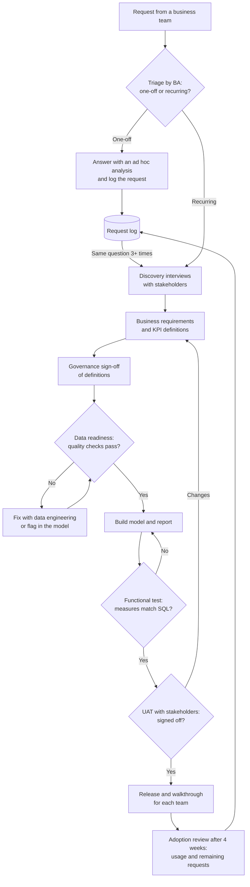

# 04 Delivery process

How a data request becomes a data product in this case. Ad hoc questions are answered and logged; recurring needs go through requirements, data readiness, testing and UAT before release.

## RACI

R = responsible, A = accountable, C = consulted, I = informed.

| Step | Business Analyst | Business stakeholders | Data engineering | Data governance | Data analyst |
|---|---|---|---|---|---|
| Triage and request log | A/R | C | I | I | C |
| Discovery interviews | A/R | C | I | I | C |
| Requirements and KPI definitions | A/R | C | C | C | C |
| Definition sign-off | R | C | I | A | I |
| Data-quality checks and fixes | R | I | A/R | C | C |
| Model and report build | A/R | I | C | I | C |
| Functional test | A/R | I | C | I | R |
| UAT and sign-off | R | A | I | I | C |
| Release and adoption review | A/R | C | I | I | C |
