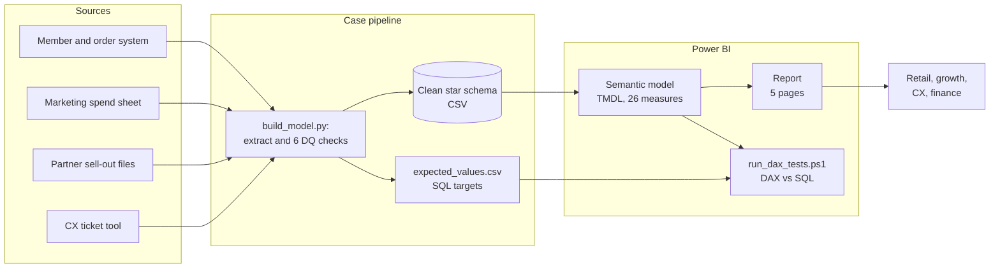

# 10 Release plan, adoption and architecture

## Releases

| Release | Scope | Status |
|---|---|---|
| R1 (this case) | US-01 to US-06, US-08 to US-10: four report pages, data-quality page, KPI definitions, tests | Done |
| R2 | US-07 channel CAC (tag members at registration, or use the BREWLY marketing-mix model); open-ticket count for CX (UAT-02); store-level drill-through for retail | Backlog |
| R3 | Move sources from CSV extracts to the data platform, scheduled refresh in the Power BI service, usage metrics | Backlog |

R1 was delivered in three two-week iterations:

| Iteration | Goal | Output |
|---|---|---|
| 1 | Discovery and definitions | Workshop 1 and 2, KPI sheet, wireframes, data-quality checks |
| 2 | Build | Star schema, 26 measures, four pages, test sheet |
| 3 | Test and release | 19 functional and 5 behaviour tests, one defect fixed, UAT, walkthrough per team |

## Adoption plan

| When | Action | Owner |
|---|---|---|
| Release week | 30-minute walkthrough per team using its own questions from workshop 1 | BA |
| Release week | One-page "how to read this report" and the KPI sheet linked from the report | BA |
| Weeks 1-4 | Office hour once a week; questions added to an FAQ | BA |
| Week 4 | Adoption review against the targets below; agree R2 priorities | BA, stakeholders |

| Adoption measure | Source | Target at week 4 |
|---|---|---|
| Weekly active viewers per team | Power BI usage metrics | At least 70% of each team |
| Routine data requests to analytics | Request log | -50% vs the 4 weeks before release |
| Numbers quoted in weekly decks that match the report | Spot check of 10 decks | 9 of 10 |
| Open questions in the FAQ | FAQ log | Falling week on week |

## Architecture

Current case (left) and the target set-up for R3 (right).

| Layer | This case | Target (R3) |
|---|---|---|
| Ingestion | Python script over extracts | Scheduled pipeline into the data platform |
| Data quality | Six rules in the build script, results loaded as a table | Same rules in the pipeline with alerts to owners |
| Model | Power BI semantic model in a PBIP project under Git | Shared semantic model, certified, with refresh schedule |
| Report | Power BI Desktop | Power BI app per audience, usage metrics on |
| Testing | DAX results compared to SQL targets | Same tests run after each deployment |
